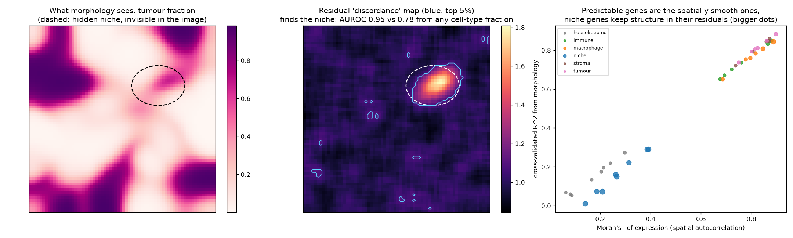

# Spatial Prediction Residuals

> The model's errors weren't random. They were where the biology was.

## Demo Output

Produced by `demo.py` from a simulated tumour section (70 x 70 spots). A hidden "niche" switches on a gene programme in tumour cells but leaves no trace in the image. Left: what morphology sees. Middle: where a morphology-to-expression model is consistently wrong. Right: each gene's spatial smoothness against how predictable it is, with dot size showing how much spatial structure is left in its residuals.

## Why This Exists

Computational pathology models that predict gene expression from H&E images are judged by accuracy. Their errors are thrown away. Iesmantas (*Comput. Biol. Med.* 2026) argued the errors carry information: regions where the predicted and measured transcriptome *disagree* mark microenvironments the image doesn't show.

In 18 Xenium breast carcinoma sections, the discordant regions had distinct expression. The paper also found that a gene's predictability tracked its spatial autocorrelation. This repo builds the same pipeline small enough to read in one sitting.

## How It Works

1. **Morphology features** per spot. Here these are noisy cell-type fractions plus texture noise. In practice they are a pathology foundation model's image embeddings.
2. **Spatially blocked cross-validation.** Spots are grouped into 10 x 10 blocks and whole blocks are held out, so a test spot's neighbours were never seen in training.
3. **Predict each gene** with ridge regression on pairwise feature products. The model is flexible enough that leftover structure isn't just "model too simple".
4. **Residuals.** For each gene, run Moran's I with a permutation test to ask whether the errors cluster in space.
5. **Discordance map.** Take the mean squared standardised residual across genes, smooth it, and threshold the top 5% as hotspots.
6. **Composition check.** Compare residuals inside and outside hotspots within tumour-rich spots only. This separates "different programme" from "different cell mix".

## What the Demo Shows

| Result | Value |
|--------|-------|
| Niche detection from residual discordance | AUROC **0.95** |
| Niche detection from any cell-type fraction | AUROC 0.78 |
| Hotspot spots that lie in the niche | 75% |
| Niche-gene residual, tumour-rich spots: hotspot vs elsewhere | +0.24 vs −0.02 |
| Niche genes with significant residual Moran's I (p < 0.01) | 8 of 8 |

The right panel shows the paper's predictability/autocorrelation link. Marker genes are smooth in space *and* predictable. That's partly because spatially smooth signals are easy to predict from anything else that is smooth.

## When NOT to Use This

- **When the model is too simple.** Structured residuals also mean "your model is wrong". With a plain linear model, the demo's marker genes had spatially clustered residuals too. Rule out misfit before calling it biology.
- **Random cross-validation on spots.** Neighbouring spots leak information. Always hold out spatial blocks, or whole sections.
- **Single sections.** One niche in one section is one observation. The paper's own cross-patient permutation test could make only nine assignments (p = 1/9).

## The Uncomfortable Truth

Residuals point to *where* to look, not *what* is there. In the paper, discordant regions differed between patients, and no universal state emerged. Treat a hotspot as a hypothesis for targeted follow-up, not as a discovered cell state.

## Further Reading

- Iesmantas T. "Prediction residuals in spatial transcriptomics reveal microenvironmental heterogeneity in cancer." Computers in Biology and Medicine (2026). doi:10.1016/j.compbiomed.2026.111995
- He B. et al. "Integrating spatial gene expression and breast tumour morphology via deep learning." Nature Biomedical Engineering (2020).
- Roberts D. R. et al. "Cross-validation strategies for data with temporal, spatial, hierarchical, or phylogenetic structure." Ecography (2017).
- Moran P. A. P. "Notes on continuous stochastic phenomena." Biometrika (1950).
